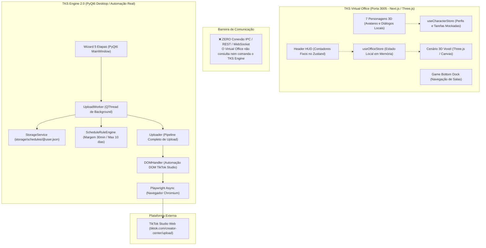
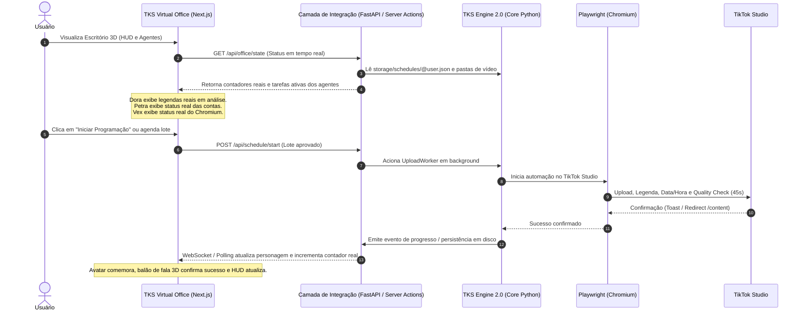

# AUDITORIA TÉCNICA — TKS ENGINE 2.0 + TKS VIRTUAL OFFICE
## Investigação Completa do Fluxo de Agendamento e Publicação no TikTok

> [!IMPORTANT]
> **Classificação:** Relatório Técnico Investigativo Independente.
> **Diretrizes Aplicadas:** NENHUM arquivo de código foi modificado. NENHUM agendamento real foi disparado. A Fase 2 NÃO foi iniciada. Todos os apontamentos foram fundamentados em inspeção estrita de código-fonte, dados em disco e execução da suíte de 78 testes unitários.

---

## A. ARQUITETURA ATUAL E SEPARAÇÃO DE RESPONSABILIDADES

A auditoria identificou a existência de **dois sistemas completamente independentes**, desenvolvidos em tecnologias distintas, executando em processos isolados e sem qualquer canal de comunicação ativo (IPC, HTTP REST, WebSocket ou banco de dados compartilhado):

1. **TKS Engine 2.0 (`e:\youtube\APPS CURSOR\AAALEKLEK\tks-engine`)**:
   - **Natureza:** Aplicação desktop nativa em **Python 3.15 + PyQt6**.
   - **Papel:** É o **único sistema que realmente executa operações**. Ele gerencia contas, valida cookies, escaneia arquivos de vídeo em disco, calcula regras de agendamento e controla o navegador Chromium via **Playwright** (`BrowserManager`, `Uploader`, `DOMHandler`).
   - **Persistência Real:** Arquivos JSON locais em `storage/schedules/<username>.json`, `storage/publishes/<username>.json` e cookies em `cookies/<username>.json`.
   - **Status Operacional:** 100% autônomo e plenamente funcional.

2. **TKS Virtual Office (`E:\youtube\APPS CURSOR\TKS-Virtual-Office`)**:
   - **Natureza:** Aplicação web frontend em **Next.js 15 + React Three Fiber + Three.js + Zustand**.
   - **Papel:** É uma **interface visual gamificada/conceitual** que representa o ambiente de trabalho e os 7 agentes da equipe (Dora, Kai, Enzo, Vex, Petra, Yuki, Nash).
   - **Comunicação com o Backend:** **INEXISTENTE**. Não há endpoints em `/api`, não há clientes HTTP (`fetch`, `axios`) e não há WebSockets.
   - **Status Operacional:** Puramente visual/simulado. Os indicadores de tela (`3 aguardando`, `1 em produção`, `5 agendados`, `12 publicados`) e o histórico de ações dos personagens estão fixados (*hardcoded*) na store Zustand (`useOfficeStore.ts` e `useCharacterStore.ts`).

### Diagrama de Arquitetura Real

---

## B. FLUXO COMPLETO DE UM VÍDEO (DA ENTRADA À PUBLICAÇÃO)

Abaixo está o mapeamento exato de cada uma das 16 etapas, identificando o arquivo, classe, método e o status real de execução:

| Etapa | Descrição Funcional | Arquivo Responsável | Método / Função | Status Real |
| :---: | :--- | :--- | :--- | :---: |
| **1** | **Recebimento / Identificação do Vídeo** | `gui/controllers/videos.py` | `VideosControllerMixin._scan_and_load_videos()` | **Operacional** (TKS Engine) |
| **2** | **Leitura de Metadados** | `utils/video_media.py` | `extract_video_metadata(path)` | **Operacional** (TKS Engine) |
| **3** | **Localização no Disco** | `utils/file_scanner.py` | `scan_video_files(directory)` | **Operacional** (TKS Engine) |
| **4** | **Preparação da Publicação** | `gui/controllers/schedule.py` | `ScheduleControllerMixin._generate_schedule()` | **Operacional** (TKS Engine) |
| **5** | **Definição da Legenda** | `gui/controllers/wizard.py` | `WizardControllerMixin._sync_caption_edits()` | **Operacional** (TKS Engine) |
| **6** | **Abertura do TikTok Studio** | `core/browser_manager.py` | `BrowserManager.launch(username)` | **Operacional** (TKS Engine) |
| **7** | **Upload do Arquivo** | `core/dom_handler.py` | `DOMHandler.upload_file(file_path)` | **Operacional** (TKS Engine) |
| **8** | **Preenchimento dos Campos** | `core/dom_handler.py` | `DOMHandler.set_caption(caption)` | **Operacional** (TKS Engine) |
| **9** | **Configuração da Data e Horário** | `core/dom_handler.py` | `DOMHandler.enable_schedule()`, `set_time()`, `set_date()` | **Operacional** (TKS Engine) |
| **10** | **Content Quality Check** | `core/dom_handler.py` | `DOMHandler.check_content_quality(max_wait=45)` | **Operacional** (TKS Engine) |
| **11** | **Espera pela Liberação do Botão** | `core/dom_handler.py` | `DOMHandler.is_post_button_enabled()` (polling 1.5s) | **Operacional** (TKS Engine) |
| **12** | **Validação do Horário Selecionado** | `core/dom_handler.py` & `core/schedule_rule_engine.py` | `DOMHandler.verify_schedule_inputs()`, `ScheduleRuleEngine.validate()` | **Operacional** (TKS Engine) |
| **13** | **Clique no Botão Programar** | `core/dom_handler.py` | `DOMHandler.click_post()` | **Operacional** (TKS Engine) |
| **14** | **Confirmação do Agendamento** | `core/dom_handler.py` | `DOMHandler.wait_post_complete(timeout=60)` | **Operacional** (TKS Engine) |
| **15** | **Registro do Resultado** | `gui/services/storage_service.py` | `GuiStorageService.append_upload_record()` em `storage/schedules/@user.json` | **Operacional** (TKS Engine) |
| **16** | **Atualização no Virtual Office** | `src/stores/useOfficeStore.ts` | **INEXISTENTE** (Sem conexão entre processos) | **Apenas Visual / Desconectado** |

---

## C. CLASSIFICAÇÃO DA INTEGRAÇÃO COM PERSONAGENS E DEPARTAMENTOS

Conforme exigido na auditoria, analisamos o comportamento ao interagir com cada elemento do **TKS Virtual Office**:

### 1. Clique em "Produção", "Publicações" ou em Departamentos
- **O que ocorre no código:** O componente `GameBottomBar.tsx` ou o clique em estações 3D dispara `focusDepartment(id)` em `useOfficeStore.ts`. A store atualiza a variável em memória `selectedDepartmentId` e abre o modal `DepartmentModal.tsx`.
- **Comunicação com o motor de agendamento:** **ZERO**. Não altera a fila do TKS Engine, não inicia processos e não envia vídeos para renderização.
- **Classificação:** **C) Funcionalidade apenas visual.**

### 2. Atuação dos 7 Personagens (Dora, Kai, Enzo, Vex, Petra, Yuki, Nash)
- **O que ocorre no código:** Os dados dos personagens são lidos do arquivo estático `src/stores/useCharacterStore.ts` (`INITIAL_CHARACTERS`). Clicar neles foca a câmera orbital e abre o `CharacterProfileModal.tsx`, que lê strings fixas como *"Revisando legendas e hashtags (#neymar)"*.
- **Execução Real:** Os personagens **não executam nenhuma tarefa em segundo plano**. Nenhuma verificação de IA, edição de vídeo ou monitoramento de rede é executada por eles.
- **Classificação:** **C) Funcionalidade apenas visual.**

### 3. Matriz de Classificação Geral de Funcionalidades

| Funcionalidade / Componente | Classificação | Evidência no Código |
| :--- | :---: | :--- |
| **Execução de Upload e Agendamento** | **A) Implementada e operacional** | `tks-engine/core/uploader.py` e `dom_handler.py` via Playwright. |
| **Validação de Regras do TikTok (30min/10d)** | **A) Implementada e operacional** | `tks-engine/core/schedule_rule_engine.py` (78 testes aprovados). |
| **Persistência de Histórico de Postagens** | **A) Implementada e operacional** | `storage/schedules/@viniciusferraz218.json` (grava status real). |
| **Wizard Desktop do TKS Engine** | **A) Implementada e operacional** | `gui/main_window.py` (PyQt6 GUI de 5 passos). |
| **HUD de Contadores do Virtual Office** | **C) Apenas visual** | `useOfficeStore.ts:38-42` (valores 3, 1, 5, 12 hardcoded). |
| **Perfis e Ações dos 7 Agentes** | **C) Apenas visual** | `useCharacterStore.ts:17-302` (dados e tarefas estáticas). |
| **Conexão IPC / API Virtual Office ↔ TKS Engine** | **D) Funcionalidade inexistente** | Nenhum socket, HTTP server ou leitor de SQLite no Virtual Office. |
| **Disparo de Agendamento pelo Virtual Office** | **D) Funcionalidade inexistente** | Botões do Virtual Office não disparam nenhuma ação no backend. |

---

## D. ESTADO DO TKS ENGINE 2.0 (AUTOMAÇÃO REAL)

A auditoria no TKS Engine 2.0 revelou que o motor de automação está **íntegro, robusto e plenamente operacional**:

1. **Execução de Testes Unitários:**
   - Comando executado: `python -m unittest discover -s tests -p "test_*.py"`.
   - Resultado: **Ran 78 tests in 98.336s — OK (100% aprovados, 0 falhas, 0 erros)**.
   - Foram testados: integridade de legendas (hashtags literais), reuso de sessão de navegador, recuperação de página travada, detecção de erros DOM, mitigação de rate limit e timeouts dinâmicos.

2. **Integridade das Legendas (Fase 2.5):**
   - O código elimina qualquer substituição de legendas vazias ou prefixação de nomes de arquivos.
   - Legendas como `#neymar` ou `#goleiros # foot` permanecem exatamente como digitadas.

3. **Mecanismo Anti-Duplicidade:**
   - Em caso de timeout de confirmação após o clique em *Programar*, o motor classifica o status como `outcome: "unknown"` e **aborta retentativas automáticas** para evitar que o vídeo seja publicado duas vezes.

---

## E. AUDITORIA DA FASE 2.6 (TIMEOUT DINÂMICO E REGRAS TIKTOK)

Verificamos minuciosamente se as correções da Fase 2.6 continuam ativas no código do TKS Engine:

1. **Timeout do Content Quality Check aumentado de 15s para 45s:**
   - **Comprovado:** Em `core/dom_handler.py:486`: `async def check_content_quality(self, max_wait_seconds: int = 45) -> dict`.
2. **Polling a cada 1,5s com liberação dinâmica imediata:**
   - **Comprovado:** Em `core/dom_handler.py:575`: `poll_interval = 1.5`. Se o botão `button[data-e2e="post_video_button"]` for habilitado aos 8s, 20s ou 35s, o loop encerra imediatamente (`core/dom_handler.py:616-620`).
3. **Regex de detecção da mensagem "Escolha um horário entre 25 min e 10 dias":**
   - **Comprovado:** Em `core/dom_handler.py:1270`: regex bilíngue compilado contendo `entre\s+\d+\s*min|between\s+\d+\s*min|escolha\s+um\s+horário|10\s+dias`.
4. **Centralização da margem mínima de 30 minutos:**
   - **Comprovado:** `config.json` define `"minOffsetMinutes": 30`, respeitado por `ScheduleRuleEngine` e validado antes de cada upload (`upload_worker.py:130`).
5. **Telemetria de liberação do botão:**
   - **Comprovado:** `core/dom_handler.py:592-596` e `core/uploader.py:217` registram nos logs e no resultado JSON o tempo exato em segundos que o botão levou para ficar ativo.

---

## F. MATRIZ DE PROBLEMAS E GARGALOS IDENTIFICADOS

| # | Gravidade | Módulo / Arquivo | Evidência Encontrada | Consequência Operacional | Possível Solução |
| :---: | :---: | :--- | :--- | :--- | :--- |
| **1** | **ALTA** | `TKS-Virtual-Office/src/stores/useOfficeStore.ts:38-42` | Contadores de vídeos (`waiting`, `processing`, `scheduled`, `published`) são números fixos no código. | O usuário vê métricas fictícias (ex: 12 publicados) que não refletem as pastas de vídeo ou o arquivo `storage/schedules/@user.json`. | Criar rota API ou leitor que leia os arquivos reais de `tks-engine/storage/schedules/` e alimente a store. |
| **2** | **ALTA** | `TKS-Virtual-Office/src/stores/useCharacterStore.ts` | Tarefas e históricos dos 7 agentes são textos estáticos gravados no TypeScript. | Nenhuma ação real dos agentes é executada; a sensação de "agentes trabalhando" é apenas uma maquete estática. | Criar um backend orquestrador que atribua jobs reais (ex: Dora lê logs de legendas, Petra lê cookies, Vex lê Playwright). |
| **3** | **MÉDIA** | `TKS-Virtual-Office/src/app` | Ausência total de camada backend ou API REST (`src/app/api`). | O Virtual Office roda como SPA puramente cliente no navegador, incapaz de disparar scripts Python ou ler o disco local. | Implementar API Routes no Next.js ou um servidor FastAPI leve em Python conectando os dois projetos. |
| **4** | **MÉDIA** | `tks-engine/core/dom_handler.py:670` | O diagnóstico do botão inativo lê nós de erro apenas após esgotar os 45 segundos. | Se o TikTok Studio apresentar uma mensagem de erro de horário logo no primeiro segundo, o sistema espera os 45s antes de abortar. | Fazer com que o polling a cada 1.5s também verifique `diagnose_disabled_button()` em caso de erro explícito na tela. |
| **5** | **BAIXA** | `tks-engine/storage/publishes/` | Pasta existe no disco mas a maior parte dos registros de agendamento fica consolidada em `storage/schedules/@user.json`. | Discrepância menor na organização interna de pastas do TKS Engine. | Padronizar a segregação estrita entre vídeos publicados imediatamente e agendados no JSON de saída. |

---

## G. FLUXO IDEAL DE INTEGRAÇÃO (COMO DEVE FUNCIONAR)

Para que o TKS Virtual Office deixe de ser uma maquete decorativa e passe a ser o **centro de comando real dos agentes**, a integração futura deve seguir o fluxo abaixo:

---

## H. PLANO DE CORREÇÃO E INTEGRAÇÃO (POR PRIORIDADE)

> [!NOTE]
> Conforme as regras inegociáveis, **nenhuma etapa abaixo foi implementada**. Este é o plano tático estruturado para autorização futura.

### Prioridade 1: Conexão de Dados Reais no HUD e Departamentos
- Criar endpoint de leitura local (Next.js API route ou script de leitura) que acesse o diretório `E:\youtube\APPS CURSOR\AAALEKLEK\tks-engine\storage\schedules/`.
- Substituir os números fixos do `useOfficeStore.ts` pelos dados reais do arquivo JSON do usuário logado.
- Exibir a lista real de vídeos nas seções de *Arquivos* e *Publicações*.

### Prioridade 2: Conexão das Tarefas dos Agentes com Eventos Reais
- Vincular o status dos agentes aos processos do TKS Engine:
  - **Dora:** Refletir a etapa de validação de legendas e hashtags.
  - **Petra:** Refletir o status dos cookies em `cookies/<user>.json`.
  - **Vex:** Refletir o status do worker de automação (idle, processando, sucesso, erro).
  - **Yuki / Nash:** Refletir métricas e histórico de uploads concluídos.

### Prioridade 3: Otimização da Detecção de Erros Precoces no DOM
- Ajustar o loop de polling em `dom_handler.py` para verificar mensagens de rejeição de horário (ex: "Escolha um horário entre 25 min e 10 dias") em cada ciclo de 1,5s, permitindo abortar imediatamente sem precisar aguardar os 45 segundos completos caso haja erro textual evidente.

---

## I. CONCLUSÃO DA AUDITORIA

1. **Como os vídeos são programados atualmente?**  
   Pelo motor **TKS Engine 2.0 (PyQt6 + Playwright)**, através da fila gerenciada por `UploadWorker`, `Uploader` e `DOMHandler`.
2. **Qual componente realmente executa o agendamento?**  
   O método `Uploader.upload_video()` invocando os métodos Playwright de `DOMHandler.py`.
3. **O Virtual Office está conectado ao mecanismo operacional?**  
   **NÃO.** O Virtual Office está 100% desconectado do motor operacional neste momento.
4. **Os 7 personagens representam processos reais ou apenas elementos visuais?**  
   **Apenas elementos visuais.** São rigs 3D com estados e textos estáticos na memória do navegador.
5. **O agendamento continua funcionando depois das mudanças?**  
   **SIM.** O TKS Engine 2.0 continua totalmente funcional, com seus 78 testes unitários aprovados e a Fase 2.6 (timeout de 45s e validação de horário) preservada.
6. **Onde estão os possíveis gargalos?**  
   Na falta de um barramento/API de comunicação entre o Virtual Office e o TKS Engine, e na exibição de dados estáticos que não refletem o disco.
