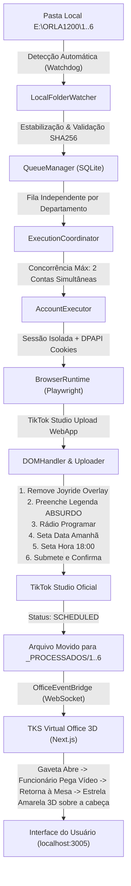

# TKS ENGINE 3.0 & VIRTUAL OFFICE — DOCUMENTO DE ARQUITETURA E CONTEXTO COMPLETO

> **Destinatário:** Desenvolvedores e Sistemas de IA de Engenharia Reversa / Automação  
> **Repositório GitHub:** `roldolfotubenuti-ui/orla1200`  
> **Status Operacional:** Produção / Modo Headless Real Ativo  
> **Data de Atualização:** 24/11/2026

---

## 1. Visão Geral e Objetivo

### 1.1 O que é o projeto
O **TKS Engine 3.0** (orla1200) é uma infraestrutura autônoma de agendamento em massa e distribuição de vídeos no **TikTok Studio**, sincronizada em tempo real com um escritório virtual gamificado 3D (**TKS Virtual Office**) em voxel art.

### 1.2 Qual problema ele resolve
A publicação e agendamento de dezenas de vídeos diários através de múltiplas contas do TikTok Studio costuma esbarrar em:
1. **Bloqueios de sessão e rate limits** por falta de isolamento estrito entre navegadores/contas.
2. **Mudanças constantes no DOM do TikTok Studio** (novos overlays de tutoriais tipo Joyride, substituição de tags `<input>` nativas por componentes complexos `Picker__root` e `TimePicker__wheel` do design system novo).
3. **Erros de validação de horário retroativo** (se o agendamento ocorrer após as 18:00 no dia atual, o TikTok bloqueia a submissão porque o horário já passou).
4. **Falta de visibilidade operacional centralizada** para múltiplos departamentos.

### 1.3 Fluxo Principal do Sistema


---

## 2. Stack Tecnológica e Dependências

O projeto é dividido em dois serviços desacoplados que operam em conjunto via REST local e WebSockets:

### 2.1 Backend: TKS Engine 3.0 (Python)
* **Linguagem:** Python 3.11+ / 3.15 (Windows x64)
* **Automação de Navegador:** `playwright >= 1.40.0` (Chromium headless e headed)
* **Servidor HTTP & WebSocket:** `aiohttp >= 3.9.0` (porta `127.0.0.1:5050`)
* **Monitoramento do Sistema de Arquivos:** `watchdog >= 3.0.0`
* **Criptografia e Segurança de Credenciais:** `ctypes.windll.crypt32` (Windows DPAPI nativo via `CryptProtectData` e `CryptUnprotectData`)
* **Banco de Dados Relacional:** `sqlite3` (`storage/tks_jobs.db`) com integridade ACID, transações isoladas e WAL mode
* **Interface Legada / Assistentes:** `PyQt6 >= 6.6.0`, `qtawesome >= 1.4.1`
* **Data & Tempo:** `python-dateutil >= 2.8.0`, biblioteca padrão `zoneinfo` (`America/Sao_Paulo`)
* **Logging & Telemetria:** `rich >= 13.9.0`, `logging` assíncrono com arquivo em `storage/engine_daemon.log`

### 2.2 Frontend: TKS Virtual Office (TypeScript / React / Next.js)
* **Framework:** Next.js 15.2.1 (App Router, Turbopack, standalone export)
* **Linguagens:** TypeScript 5.8.2, React 19.0.0, React DOM 19.0.0
* **Motor 3D:** Three.js 0.174.0, `@react-three/fiber 9.8.2`, `@react-three/drei 10.7.9`
* **Gerenciamento de Estado Global:** `zustand 5.0.3` (`useOfficeStore`, `useCharacterStore`, `useDrawerSystemStore`)
* **Estilização e UI:** Tailwind CSS, `clsx`, `tailwind-merge`, `lucide-react`
* **Concorrência e Scripts:** `concurrently` (para subida unificada)

---

## 3. Arquitetura e Árvore de Diretórios

### 3.1 Estrutura do Workspace Principal (`tks-engine/`)
```text
AAALEKLEK/tks-engine/
├── core/
│   ├── account_executor.py          # Executa jobs individuais na sessão Playwright da conta
│   ├── account_manager.py           # CRUD de contas, mapeamento de cookies DPAPI e status
│   ├── account_model.py             # Dataclass da conta (username, auth_status, department_id)
│   ├── browser_runtime.py           # Gerenciador global do ciclo de vida do Chromium
│   ├── context_registry.py          # Isolamento de BrowserContext e injeção de cookies por conta
│   ├── cookie_validator.py          # Validação estrutural de cookies de sessão TikTok
│   ├── daily_scheduler_rule.py      # Algoritmo de cálculo de próximo horário consecutivo (18:00 SP)
│   ├── db_manager.py                # Singleton de conexão SQLite e migrações de schema
│   ├── dom_handler.py               # Manipulação do DOM do TikTok Studio (seletores, date/time pickers)
│   ├── dpapi_crypto.py              # Encriptação/decriptação de cookies com chave mestra do Windows
│   ├── execution_coordinator.py     # Orquestrador de concorrência (máx 2 jobs globais, 1 por conta)
│   ├── local_engine_daemon.py       # API REST/WebSocket (porta 5050) para controle pelo Virtual Office
│   ├── local_folder_watcher.py      # Monitor contínuo Watchdog das 6 pastas em E:\ORLA1200\
│   ├── office_event_bridge.py       # Barramento Pub/Sub de eventos em tempo real
│   ├── queue_manager.py             # Fila de tarefas, estados de transição e deduplicação
│   ├── round_robin_router.py        # Roteamento de tarefas entre contas ativas
│   └── uploader.py                  # Pipeline sequencial de upload, legenda, data, hora e submissão
├── storage/
│   ├── tks_jobs.db                  # Banco de dados SQLite de produção
│   ├── accounts.json                # Cadastro de contas e metadados
│   └── engine_daemon.log            # Log operacional detalhado
├── cookies/                         # Cookies encriptados via DPAPI (*.enc) por conta
├── run_engine_headless.py           # Entrypoint do daemon em segundo plano (com flag --real)
├── setup.py                         # Instalação e verificação de dependências
└── requirements.txt                 # Dependências pip
```

### 3.2 Estrutura do Frontend (`TKS-Virtual-Office/`)
```text
TKS-Virtual-Office/
├── src/
│   ├── app/
│   │   ├── layout.tsx               # Root layout com tema escuro e fontes
│   │   ├── page.tsx                 # View principal do escritório 3D e HUDs
│   │   └── api/engine/              # Rotas proxy conectadas ao daemon na porta 5050
│   ├── components/3d/
│   │   ├── Scene.tsx                # Canvas R3F, iluminação, sombras e câmera orbital
│   │   ├── building/                # Modelagem do loft, piso voxel, janelas e paredes
│   │   ├── characters/              # Avatares 3D dos funcionários (Mesa 1 a 6)
│   │   │   ├── employee/            # Rigs específicos (Lutador, Pato, Cientista, etc.)
│   │   │   └── useEmployeeVideoRoutine.ts # Rotina cinemática (gaveta -> mesa)
│   │   ├── furniture/               # Armário de arquivo com as 6 gavetas animadas
│   │   └── props/
│   │       ├── VideoCartridgeProp.tsx # Fita VHS 3D que o funcionário carrega
│   │       └── VoxelStarProp.tsx    # Estrela amarela 3D que surge sobre a cabeça no sucesso
│   ├── components/ui/
│   │   ├── OperationsCentralModal.tsx # Painel completo da Central de Operações 3.0
│   │   └── GameBottomBar.tsx        # Barra de atalhos e status rápido
│   └── stores/
│       ├── useOfficeStore.ts        # Estado de câmeras, presets e HUD
│       └── useDrawerSystemStore.ts  # Estado das gavetas, arquivos pendentes e estrelas
```

---

## 4. Fluxo de Dados e Regras de Negócio

### 4.1 Mapeamento Obrigatório de Pastas e Contas
O sistema mantém uma correspondência 1:1 estrita e imutável entre pastas do disco, departamentos, funcionários e gavetas:

| Pasta | Departamento | Funcionário | Gaveta 3D | Conta TikTok Vinculada |
|---|---|---|---|---|
| `E:\ORLA1200\1` | Instagram | `employee-01` | `drawer-01` | `@unamyti` |
| `E:\ORLA1200\2` | Mercado Livre | `employee-02` | `drawer-02` | `@valueini` |
| `E:\ORLA1200\3` | Shorts | `employee-03` | `drawer-03` | `@vinihack537` |
| `E:\ORLA1200\4` | TikTok | `employee-04` | `drawer-04` | `@vinihack979` |
| `E:\ORLA1200\5` | TikTok Shop | `employee-05` | `drawer-05` | `@vinihack120` |
| `E:\ORLA1200\6` | YouTube | `employee-06` | `drawer-06` | `@viniciusferraz218` |

### 4.2 Regras de Agendamento Inteligente (`core/daily_scheduler_rule.py`)
1. **Configuração Base:**
   * Horário padrão: `18:00:00`
   * Fuso horário: `America/Sao_Paulo` (GMT-3)
   * Limite: `1 vídeo por conta por dia`
   * Legenda padrão de teste: `ABSURDO`
2. **Cálculo da Data Alvo:**
   * O sistema consulta todos os agendamentos já registrados no SQLite para a conta em questão.
   * Se a data atual já tiver ultrapassado as `17:35` (menos de 25 min antes das 18:00) ou já possuir agendamento para hoje, **o sistema calcula automaticamente a data para amanhã às 18:00**.
   * Se amanhã já estiver ocupado (por um segundo vídeo na mesma pasta), ele avança para o segundo dia consecutivo (`D+2`), e assim sucessivamente até esgotar os arquivos da fila.
   * **Ordem Obrigatória no TikTok Studio:** Ao abrir o formulário, o `DOMHandler` **sempre altera a data antes de alterar o horário**. Isso evita que o TikTok Studio bloqueie o botão de agendamento por considerar que as 18:00 de hoje já ficaram no passado.

### 4.3 Tratamento do Novo DOM do TikTok Studio (`core/dom_handler.py`)
* **Remoção de Overlays Obstrutivos:** O TikTok Studio renderiza portais do React Joyride (`#react-joyride-portal`, `.react-joyride__overlay`, `.react-joyride__tooltip`). Esses elementos interceptam eventos de ponteiro. O `dom_handler` executa remoção direta via JavaScript no DOM antes de qualquer interação.
* **Componentes DatePicker e TimePicker Novos:**
  * O disparador de data é localizado via `div.scheduled-picker div[role='combobox'][aria-label*='date' i]` ou `.Picker__trigger`.
  * Os dias do calendário são selecionados diretamente através de `button.DatePicker__day` filtrando pelo dia e validando `data-disabled !== 'true'`.
  * O disparador de horário abre `.TimePicker__panel--columns-two`, onde as colunas `[aria-label="Hours"]` e `[aria-label="Minutes"]` são clicadas diretamente pelos botões `button.TimePicker__item`.
  * O dropdown é fechado com tecla `Escape` para liberar o foco para o botão de publicação.

### 4.4 Arquivamento Atômico de Vídeos Processados
* Um vídeo **nunca** é removido do disco se o agendamento falhar (`FAILED`) ou requerer login (`REAUTH_REQUIRED`).
* Apenas após a confirmação visual no DOM do TikTok Studio (`"Your video has been scheduled"` ou modal `"Vídeo programado"` / transição para `SCHEDULED`), o arquivo é movido da pasta de entrada para a pasta arquivada:
  `E:\ORLA1200\_PROCESSADOS\<id_pasta>\<nome_original.mp4>`

---

## 5. Configurações e Comandos de Execução

### 5.1 Requisitos de Ambiente
* Windows 10/11 x64 (necessário para DPAPI nativo do Windows).
* Node.js v18+ ou v20+.
* Python 3.11+.

### 5.2 Inicialização dos Serviços

#### 1. Iniciar o Escritório Virtual 3D (Next.js)
```powershell
cd "E:\youtube\APPS CURSOR\TKS-Virtual-Office"
npm install
npm run build
npx next start -p 3005 -H 0.0.0.0
```
*Acessível em:* `http://localhost:3005`

#### 2. Iniciar o Motor TKS 3.0 Headless (Modo Real)
```powershell
cd "E:\youtube\APPS CURSOR\AAALEKLEK\tks-engine"
pip install -r requirements.txt
python run_engine_headless.py --real
```
*API local:* `http://127.0.0.1:5050`

---

## 6. Estado Atual, Pendências e Bugs Conhecidos

### 6.1 O que está 100% Funcional e Homologado
1. **Deduplicação e Watcher Local:** O `LocalFolderWatcher` monitora as 6 pastas com isolamento por `account_id` e `department_id`, impedindo que o mesmo hash SHA256 em departamentos diferentes seja bloqueado indevidamente.
2. **Isolamento de Sessões Playwright:** Concorrência máxima de 2 contas simultâneas, cada uma em seu próprio `BrowserContext` isolado com cookies protegidos por DPAPI.
3. **Novos Seletores do TikTok Studio:** Remoção forçada do Joyride overlay e interação completa com os novos pickers de calendário e horário.
4. **Virtual Office 3D Integrado:** As 6 mesas possuem o rig com a estrela amarela pequena (`VoxelStarProp.tsx`) que é acionada sobre a cabeça do personagem quando o agendamento é confirmado via WebSocket.
5. **Repositório GitHub Configurado:** Repositório criado e tornado público em `https://github.com/roldolfotubenuti-ui/orla1200`.

### 6.2 Limitações e Próximos Passos (TODOs)
* **Validade dos Cookies das Contas TikTok:** A conta `@viniciusferraz218` (Mesa 6 / YouTube) está com status `STRUCTURALLY_VALID`, enquanto as outras 5 estão `AUTHENTICATED`. Recomenda-se revalidar periodicamente a sessão dessa conta se houver expiração no TikTok.
* **Monitoramento de Falha de Conexão com a Internet:** Se a conexão cair durante o upload de um vídeo de 50MB+, o timeout do Playwright (120s) classifica o job como `FAILED`. O motor já possui retry com backoff, mas não reinicia o arquivo do zero no mesmo ciclo.
* **Interface da Central de Operações:** O botão "Validar Sessões das Contas" no modal dispara testes no backend via `/api/accounts/test`; garantir que o usuário não clique repetidamente enquanto 2 uploads reais estiverem em andamento para não estourar o limite de 2 sessões simultâneas do Playwright.
